# Spark Structured Streaming: File Source → Console Sink


### Starting Docker Desktop

```bash

systemctl --user start docker-desktop

```

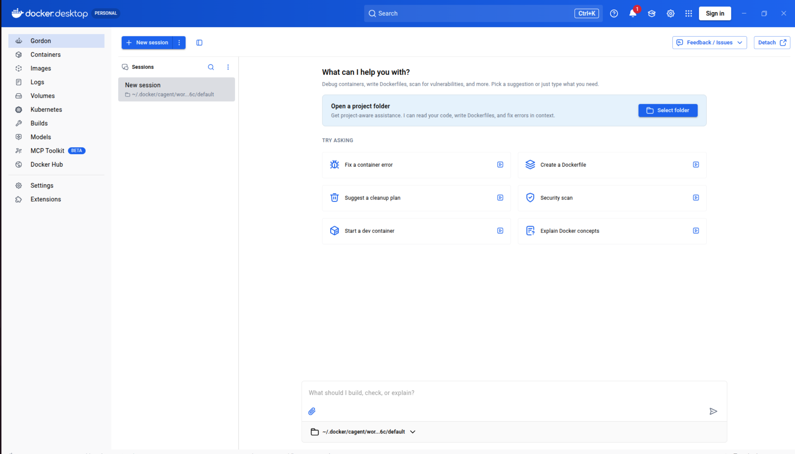

### Building the Spark 4.1.4 Docker image

```bash

docker compose build spark
docker images

```

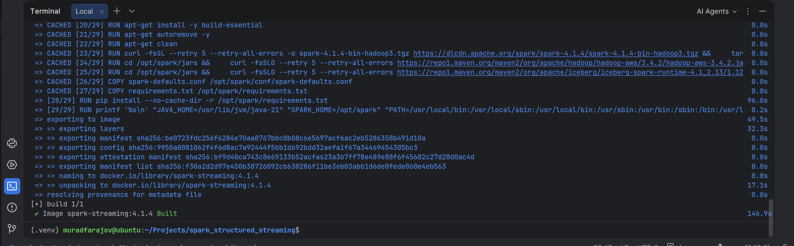

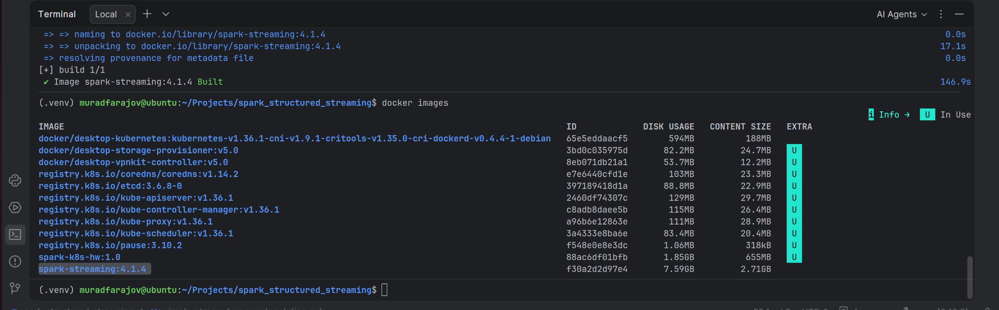


## Starting Spark and RustFS containers

### Starting Docker Compose

```bash

docker compose up -d

docker compose ps

docker exec -it spark_streaming spark-submit --version

```

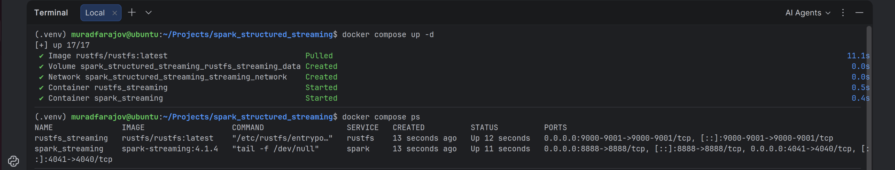


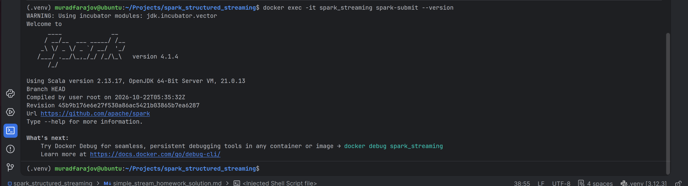


## Opening RustFS in browser: http://localhost:9001

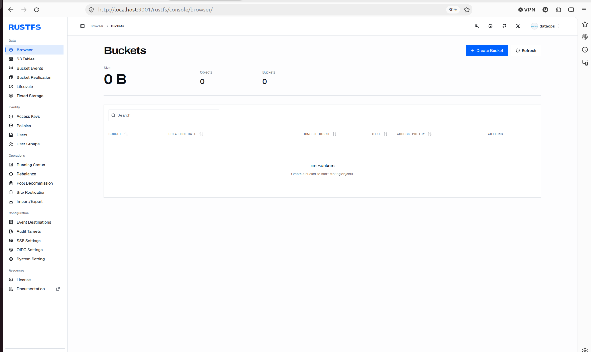


### Create datasets bucket
### This bucket will hold the IoT temperature CSV files generated during our homework

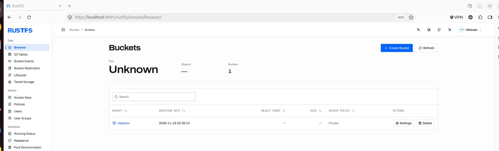


## Download the IoT Temperature Dataset

```bash

wget -O data/IOT-temp.csv.zip \
https://github.com/erkansirin78/datasets/raw/master/IOT-temp.csv.zip

```

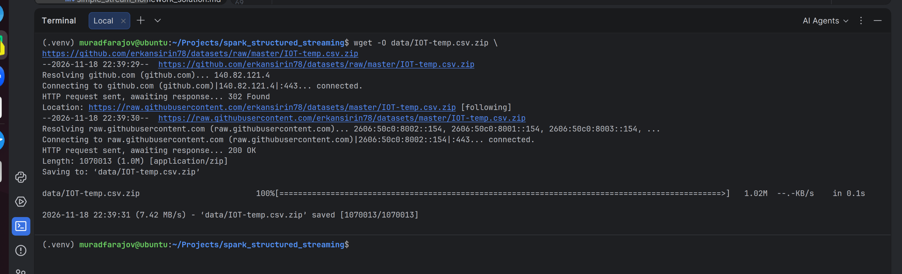


### Extract the ZIP file

```bash

unzip data/IOT-temp.csv.zip -d data/

ls -lh data/

head -n 5 data/IOT-temp.csv

```

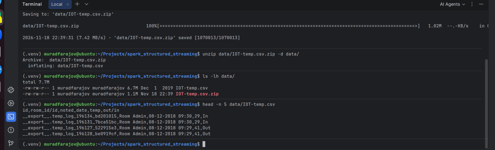


## Homework requires a data-generator that continuously uploads small CSV files to RustFS

### We'll create a Python script that reads the existing CSV file, splits it into smaller batches, 
### adds the gentime_time ingestion timestamp, and uploads those batches to RustFS.

### Install the Python library: boto3

```bash

pip install boto3

```
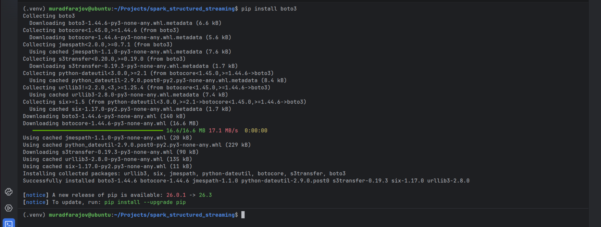


### Creating the data-generator file: data_generator.py

## The generator will:
### 1. Read IOT-temp.csv.
### 2. Take 10 records at a time.
### 3. Add gentime_time to each record.
### 4. Generate a new CSV file.
### 5. Upload the file to RustFS.
### 6. Repeat every five seconds.

```python

import csv
import io
import time
from datetime import datetime

import boto3

# RustFS connection
S3_ENDPOINT = "http://localhost:9000"
ACCESS_KEY = "dataops"
SECRET_KEY = "Ankara06"

BUCKET_NAME = "datasets"
PREFIX = "iot-temp-input/"

# Dataset
SOURCE_FILE = "data/IOT-temp.csv"

# Streaming configuration
BATCH_SIZE = 10
INTERVAL_SECONDS = 5

s3 = boto3.client(
    "s3",
    endpoint_url=S3_ENDPOINT,
    aws_access_key_id=ACCESS_KEY,
    aws_secret_access_key=SECRET_KEY,
    region_name="us-east-1",
)

with open(SOURCE_FILE, "r", encoding="utf-8-sig", newline="") as file:

    reader = csv.DictReader(file)

    fieldnames = list(reader.fieldnames) + ["gentime_time"]

    batch = []
    batch_number = 0

    for row in reader:

        row["gentime_time"] = datetime.now().strftime(
            "%Y-%m-%d %H:%M:%S.%f"
        )

        batch.append(row)

        if len(batch) >= BATCH_SIZE:

            output = io.StringIO()

            writer = csv.DictWriter(output, fieldnames=fieldnames)
            writer.writeheader()
            writer.writerows(batch)

            object_key = f"{PREFIX}batch_{batch_number:05d}.csv"

            s3.put_object(
                Bucket=BUCKET_NAME,
                Key=object_key,
                Body=output.getvalue().encode("utf-8"),
                ContentType="text/csv",
            )

            print(
                f"Uploaded {object_key} "
                f"({len(batch)} records)"
            )

            batch.clear()
            batch_number += 1

            time.sleep(INTERVAL_SECONDS)

print("Data generation completed.")

```

## We create the Spark application so we can observe incoming data

### Under spark - examples folder creating: simple_stream_homework.py

### We already installed PySpark inside our Docker image.
### We do not need to install PySpark locally to execute the application inside Docker. 
### The red underlines won't prevent Docker from running it.


```python
from pyspark.sql import SparkSession, functions as F
from pyspark.sql.types import (
    StructType,
    StructField,
    StringType,
    IntegerType
)

# --------------------------------------------------
# 1. Create Spark Session
# --------------------------------------------------

spark = (
    SparkSession.builder
    .appName("Week10_IOT_Temperature_Streaming")
    .master("local[2]")
    .getOrCreate()
)

spark.sparkContext.setLogLevel("ERROR")

# --------------------------------------------------
# 2. Define CSV Schema
# --------------------------------------------------

iot_schema = StructType([
    StructField("id", StringType(), True),
    StructField("room_id/id", StringType(), True),
    StructField("noted_date", StringType(), True),
    StructField("temp", IntegerType(), True),
    StructField("out/in", StringType(), True),
    StructField("gentime_time", StringType(), True)
])

# --------------------------------------------------
# 3. Read Streaming Data from RustFS
# --------------------------------------------------

df = (
    spark.readStream
    .format("csv")
    .schema(iot_schema)
    .option("header", "true")
    .option("maxFilesPerTrigger", 1)
    .load("s3a://datasets/iot-temp-input/")
)

# --------------------------------------------------
# 4. Rename Columns
# --------------------------------------------------

df_clean = (
    df
    .withColumnRenamed("room_id/id", "room_id_id")
    .withColumnRenamed("out/in", "out_in")
)

# --------------------------------------------------
# 5. Add Event-Time Columns
# --------------------------------------------------

df_enriched = (
    df_clean
    .withColumn(
        "noted_date_ts",
        F.to_timestamp(
            F.col("noted_date"),
            "dd-MM-yyyy HH:mm"
        )
    )
    .withColumn(
        "event_year",
        F.year("noted_date_ts")
    )
    .withColumn(
        "event_month",
        F.month("noted_date_ts")
    )
    .withColumn(
        "event_day",
        F.dayofweek("noted_date_ts")
    )
)

# --------------------------------------------------
# 6. Write Streaming Data to Console
# --------------------------------------------------

query = (
    df_enriched.writeStream
    .format("console")
    .outputMode("append")
    .trigger(processingTime="5 seconds")
    .option("numRows", 10)
    .option("truncate", True)
    .option(
        "checkpointLocation",
        "s3a://datasets/checkpoints/iot-temp-console"
    )
    .start()
)

# --------------------------------------------------
# 7. Keep Streaming Application Running
# --------------------------------------------------

query.awaitTermination()

```

## Running the Spark Structured Streaming application

### Verifying Spark can reach RustFS

```bash

docker exec spark_streaming curl -I http://rustfs:9000

```

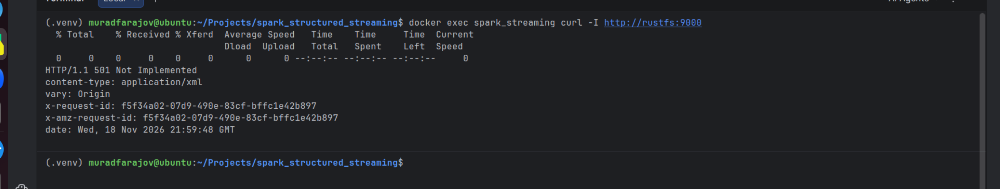


### Create the source directory in RustFS

```bash

python - <<'PY'
import boto3

s3 = boto3.client(
    "s3",
    endpoint_url="http://localhost:9000",
    aws_access_key_id="dataops",
    aws_secret_access_key="Ankara06",
    region_name="us-east-1"
)

s3.put_object(
    Bucket="datasets",
    Key="iot-temp-input/initial.csv",
    Body=(
        "id,room_id/id,noted_date,temp,out/in,gentime_time\n"
        "test_001,Room Admin,08-12-2018 09:30,29,In,2026-11-18 22:00:00\n"
    ).encode("utf-8"),
    ContentType="text/csv"
)

print("Initial CSV uploaded successfully!")
PY

```

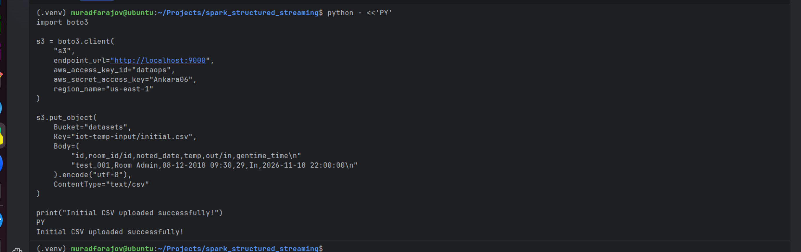


### iot temp input - initial.csv
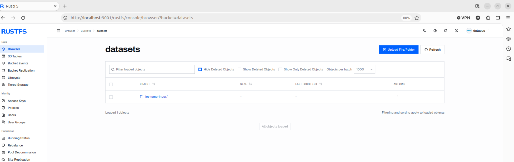
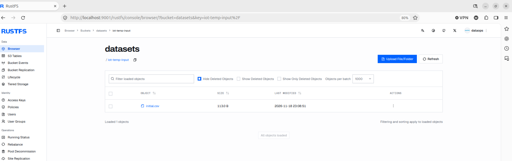


### terminal 1: spark-submit
```bash

docker exec -it spark_streaming spark-submit \
  --master 'local[2]' \
  --conf spark.hadoop.fs.s3a.endpoint=http://rustfs:9000 \
  --conf spark.hadoop.fs.s3a.access.key=dataops \
  --conf spark.hadoop.fs.s3a.secret.key=Ankara06 \
  --conf spark.hadoop.fs.s3a.path.style.access=true \
  --conf spark.hadoop.fs.s3a.impl=org.apache.hadoop.fs.s3a.S3AFileSystem \
  /opt/examples/simple_stream_homework.py

```

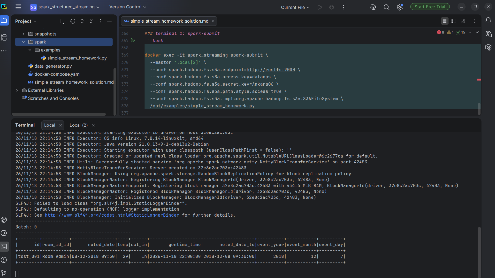


### terminal 2: run data-generator

```bash

python data_generator.py

```

###  Look at Terminal 2
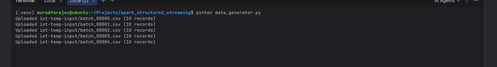

### Check terminal 1
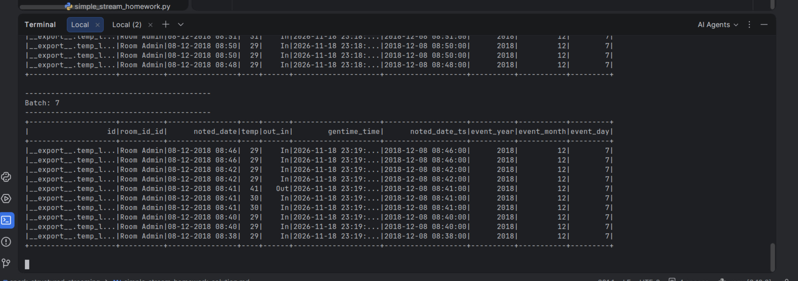


### Verify RustFS
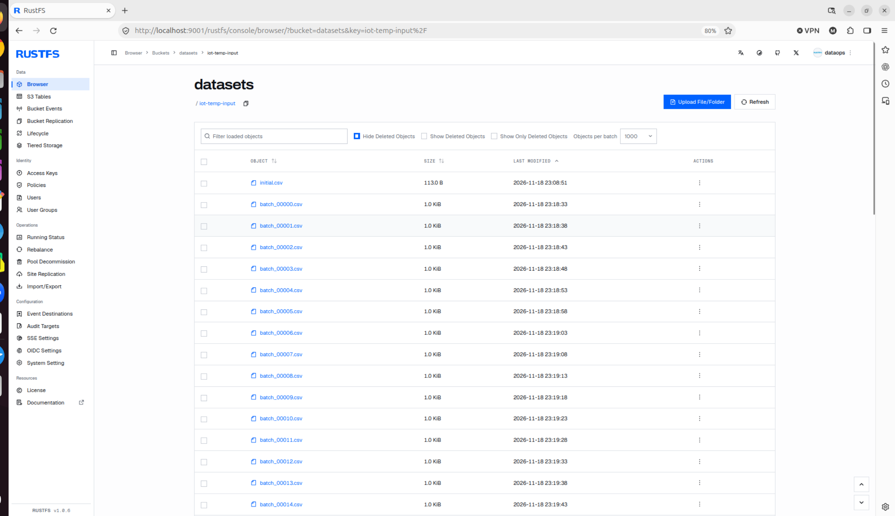